# Regression Prediction Models | LSTM, CNN, Transformer, TCN, Serial, Parallel Model Collection

1 Collection Update Introduction
1.1 Added SSHAP Visualization Analysis
1.2 Collection Overview
What is regression prediction? What are the differences from general time series prediction?
(1) Regression prediction:
Regression prediction generally refers to using features to predict a continuous target variable. For example, predicting house prices based on factors such as the area of the house, geographical location, and age. In regression prediction, the target variable is usually a continuous real number, which can be any value within a range.
The features in regression prediction can include various types of data, including numerical, categorical, and textual, while the target variable is a continuous real number.
Common regression models include linear regression, Ridge regression, Lasso regression, decision tree regression, random forest regression, etc.
(2) Time series prediction:
Time series prediction refers to predicting future values based on a series of data points arranged in chronological order. These data points are typically collected at fixed time intervals, such as daily, monthly, or annually.
The goal of time series prediction is to predict future values based on past data, so the temporal order is very important in the prediction task.
Time series prediction often involves some specific methods, such as ARIMA model, LSTM (Long Short-Term Memory) neural network, Prophet model, etc., which can fully utilize the temporal structure and periodicity in the data.
Dataset: Kaggle platform—Flood Dataset
Environment framework: Python 3.9, PyTorch 2.1 and above versions can run
Use object: Beginners learning, paper requirements
Code guarantee: Code comments are detailed, ready to run without modification.
Supporting files: Comprehensive environment setup and installation tutorials, model, parameter explanation documents
1. Creation of regression prediction dataset, data loading, model definition, parameter setting, model training, model testing, predictive visualization, model evaluation
3. Regression Model Based on CNN-SENet
\t3.1 Define the CNN-SENet network model
\t3.2 Set parameters and train the model
50 epochs, extremely low MSE, CNN-SENet significantly improves performance. The model effectively extracts multi-scale features from the data, converges quickly, and exhibits exceptionally superior performance with noticeable results.
4. Model Evaluation and Visualization
\t4.1 Model Evaluation
\t4.2 Regression Prediction Fitting
\t4.3 SHAP Explanatory Analysis
Added visualization comparison: \n        \n      \n        \n  
\n        \n  
Update Introduction:
\t1. \tAdded Attention Mechanism Model:
\t  
\t2. Added Combination Prediction Model:
\t  
\t3. Added KAN Network Combination Prediction Model:
\n        \n  
  
Including complete process data code processing:
Data preparation for regression prediction, data loading, model definition, parameter setting, model training, model testing, predictive visualization, model evaluation.
Code and file introduction:
Preface
This article introduces the XGBoost model, a powerful regression prediction model in the family of Kaggle platform—Hydro Dataset Regression Prediction (dataset attached at the end).
The dataset consists of 50,000 samples with 20 features, used to predict the FloodProbability (Flood Probability): This outcome variable is predicted based on the aforementioned factors, representing a probability between 0 and 1.
1 Data preprocessing
2. Regression Prediction Model Based on XGBoost
\t2.1 XGBoost parameter optimization process
The number of trees
\t  
\tDepth of the tree
\t  
Learning rate
\t  
\t  
3 Results Visualization and Prediction, Model Evaluation
3.1 Visualization of Prediction Results
3.2 Model Evaluation
Previously Featured Content:
Time Series Forecasting: Analysis and comparison of LSTM, ARIMA, Holt-Winters, SARIMA models
Wind Speed Prediction (Part 1) Data Set Introduction and Preprocessing
Wind Speed Prediction (II) EMD-LSTM Model Based on Pytorch
Wind Speed Prediction (III) EMD-LSTM-Attention Model
Wind Speed Prediction (IV) EMD-Transformer Model Based on Pytorch
Wind Speed Prediction (5) EMD-CNN-LSTM Model Based on Pytorch
Wind Speed Prediction (VI) - EMD-CNN-GRU Parallel Model Based on Pytorch
CEEMDAN + Combination Forecasting Model (BiLSTM-Attention + ARIMA)
CEEMDAN + Combination Prediction Model (CNN-LSTM + ARIMA)
CEEMDAN + Combination Prediction Model (Transformer - BiLSTM + ARIMA)
CEEMDAN + Combination Prediction Model (CNN-Transformer + ARIMA)
Multi-Feature Variable Sequence Forecasting (I) - CNN-LSTM Wind Speed Forecasting Model
Multi-Feature Variable Sequence Forecasting (II) - CNN-LSTM-Attention Wind Speed Forecasting Model
Multi-Feature Variable Sequence Forecasting (III) - CNN-Transformer Wind Speed Forecasting Model
Multi-Feature Variable Sequence Forecasting (IV) Transformer-BiLSTM Wind Speed Forecasting Model
Multi-Feature Variable Sequence Forecasting (V) CEEMDAN+CNN-LSTM Wind Speed Forecasting Model
Multi-Feature Variable Sequence Forecasting (VI) CEEMDAN+CNN-Transformer Wind Speed Forecasting Model
Prediction Model Based on the Particle Swarm Optimization Algorithm SSA - CEEMDAN-BiLSTM-Attention
Prediction Model Based on the Particle Swarm Optimization Algorithm SSA - CEEMDAN-Transformer-BiGRU
Superior Prediction Model: Secondary Decomposition-Combination Prediction
Multi-Feature Variable Sequence Forecasting (VII) CEEMDAN+Transformer-BiLSTM Prediction Model
Multi-Feature Variable Sequence Forecasting (VIII) Prediction Model Based on Particle Swarm Optimization Algorithm for CEEMDAN-SSA-BiLSTM
Multi-Feature Variable Sequence Forecasting (11) Prediction Model Based on Pytorch's TCN-GRU
VMD + CEEMDAN Secondary Decomposition, CNN-LSTM Prediction Model
VMD + CEEMDAN Secondary Decomposition, CNN-Transformer Prediction Model
VMD + CEEMDAN Secondary Decomposition, Transformer-BiGRU Prediction Model
Predictive Model Based on the Plumage Optimization Algorithm SSA - Complete Code Kit
Introduction to Electric Power Transformer Data Set and Preprocessing
 | Sci-1st Class High Innovation Predictive Model!
END

## Images

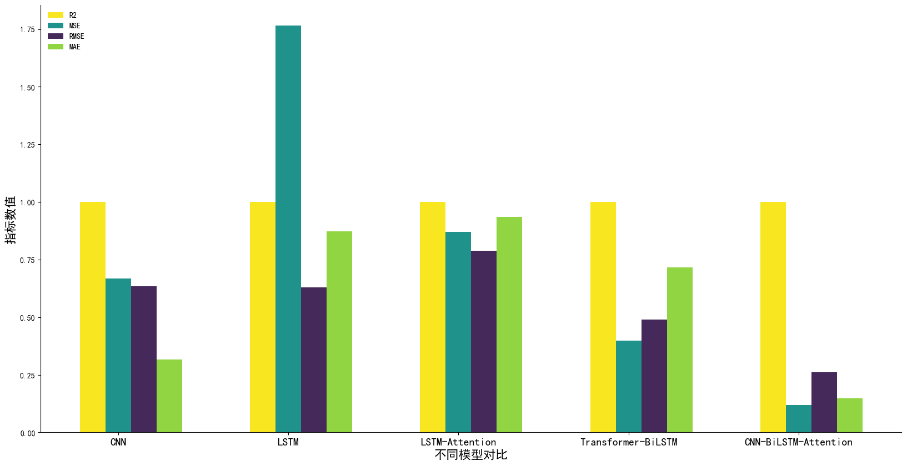
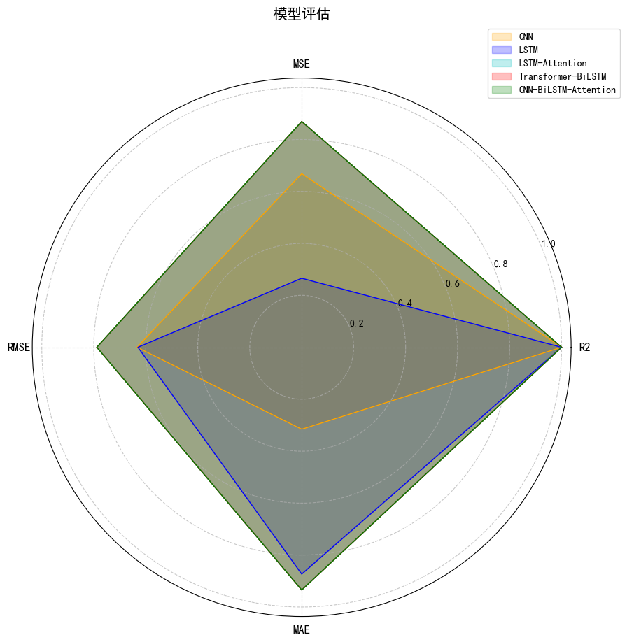
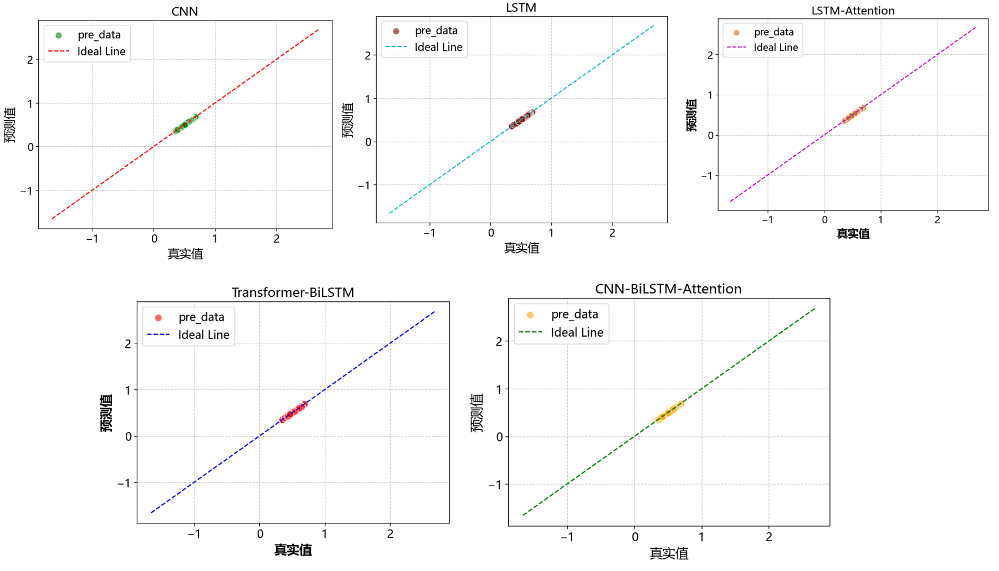
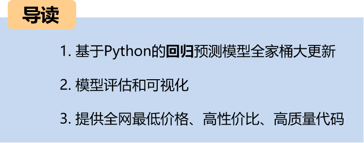
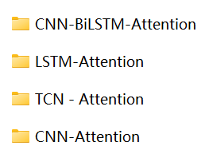
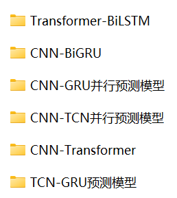
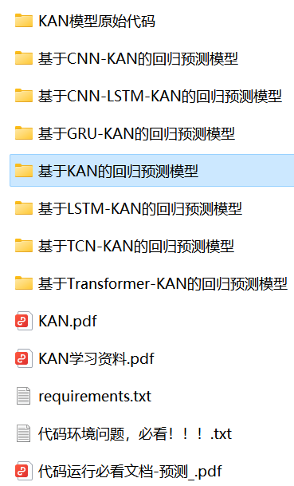

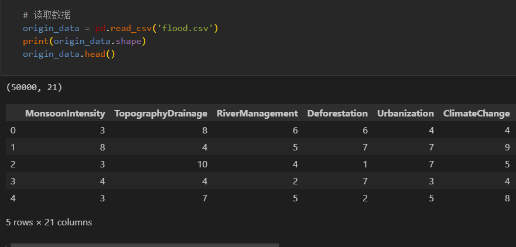
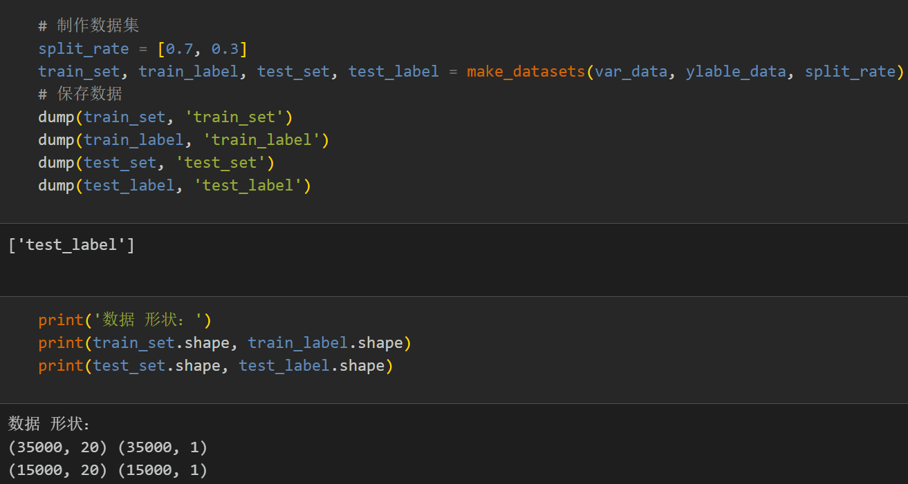
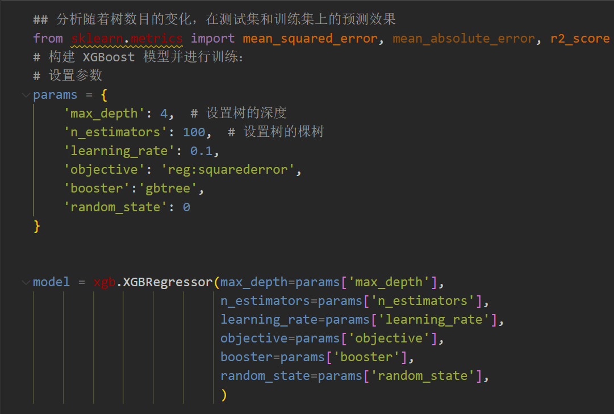
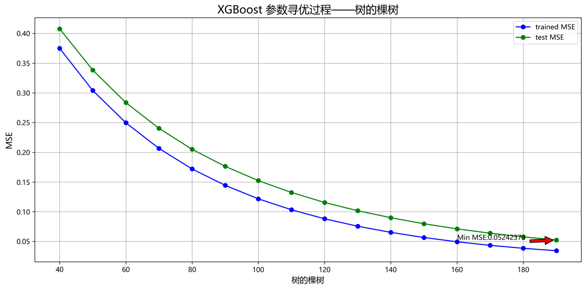
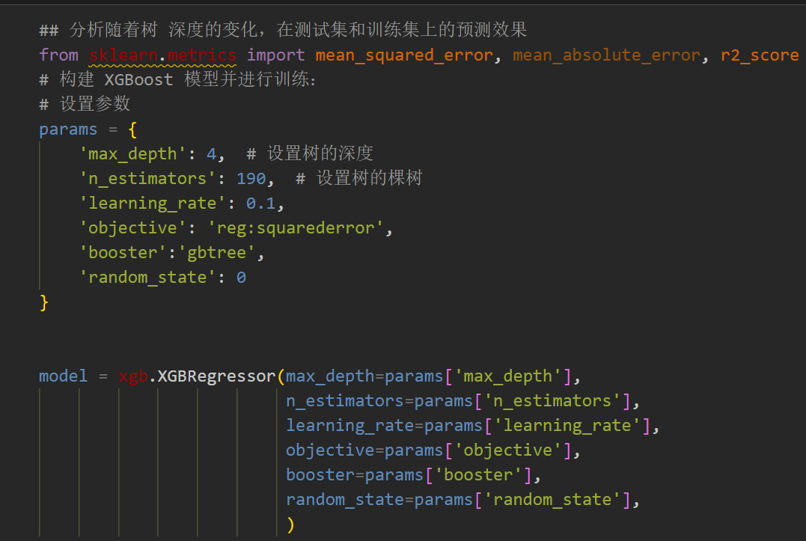
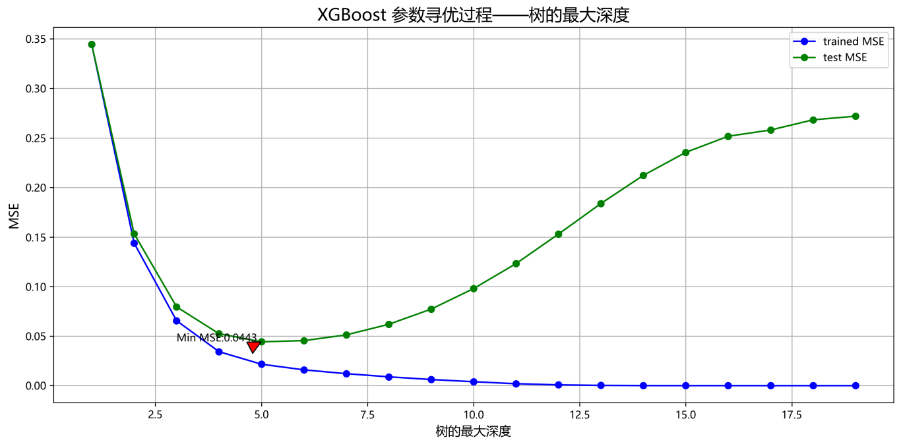
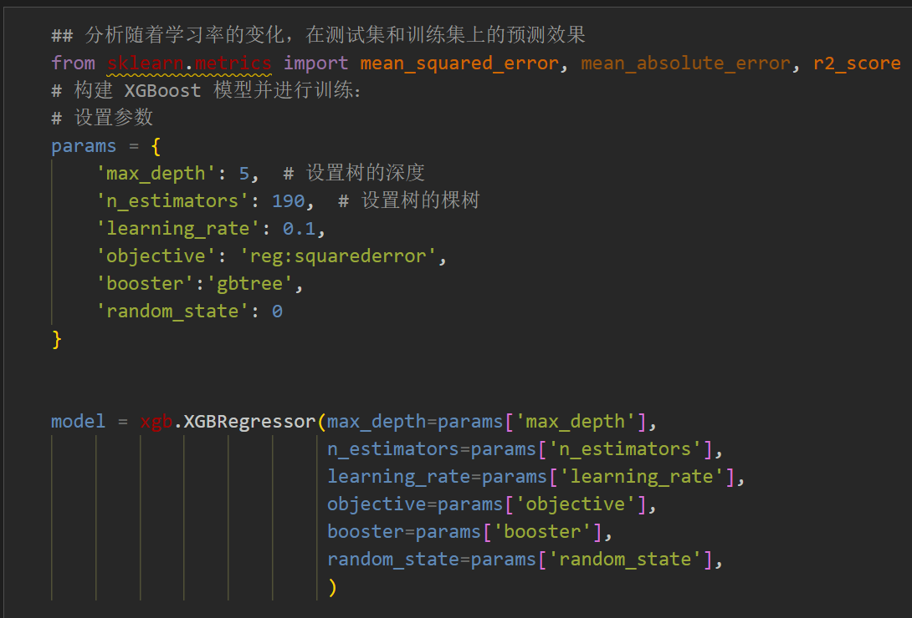
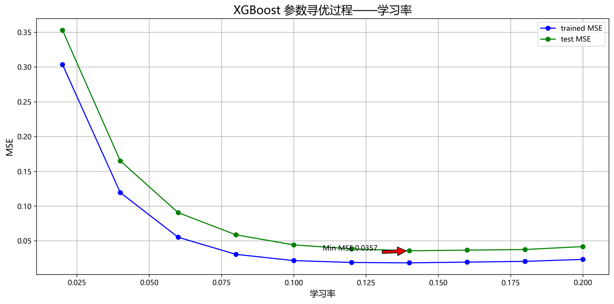
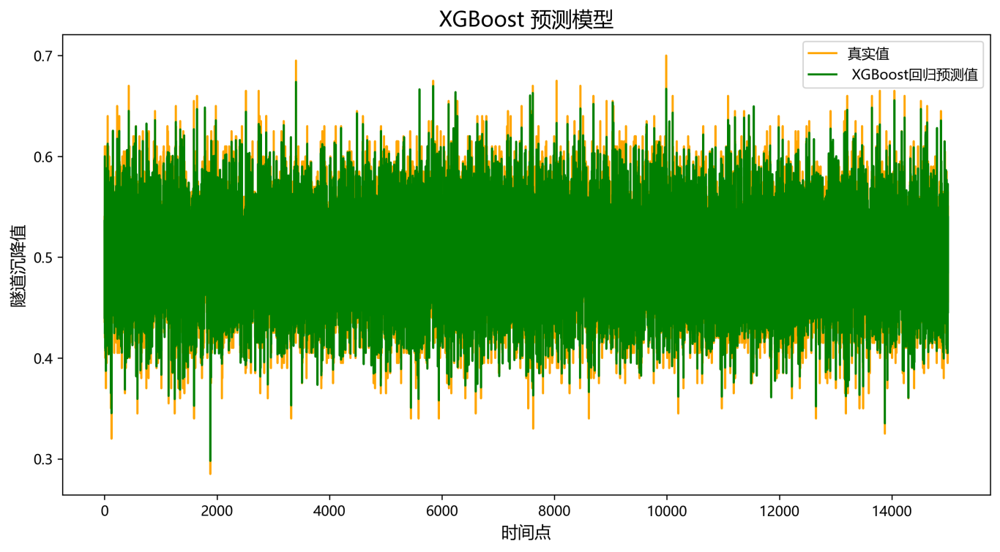
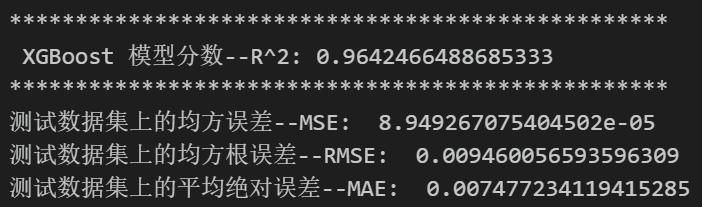
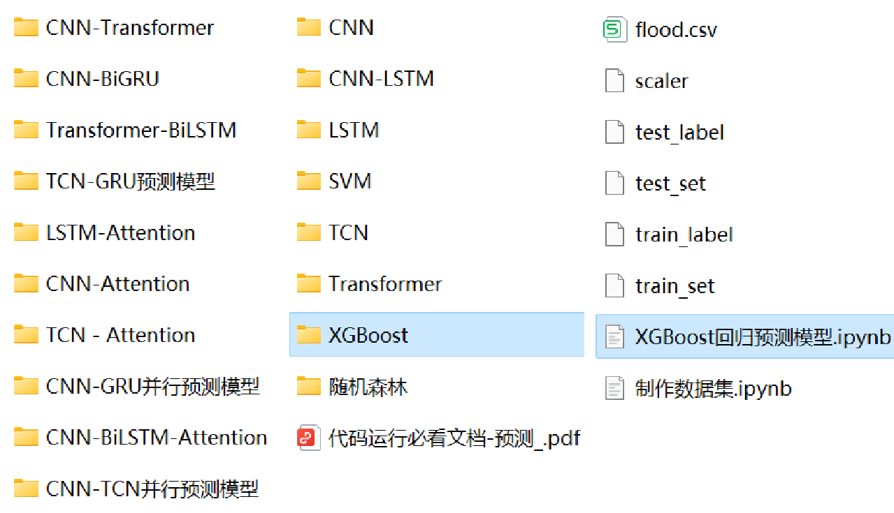

<!-- PAYMENT_BLOCK -->

## Get this dataset

- Payment link (Stripe): [Buy now](https://buy.stripe.com/3cs8yP7sY87d0vu9AB)
- Payment QR code: 

<!-- /PAYMENT_BLOCK -->
